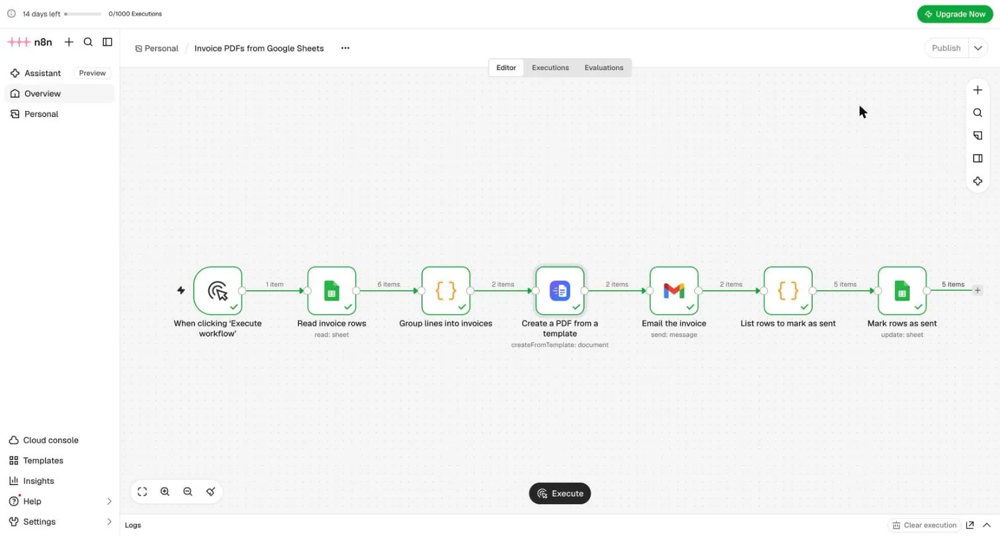
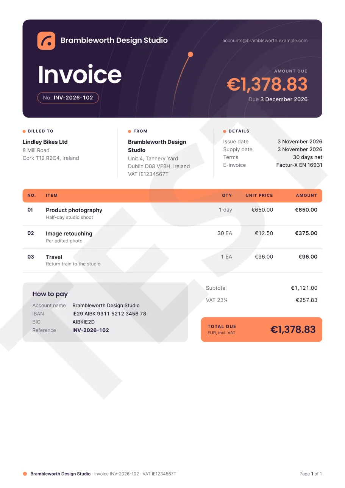

# Invoice PDFs from Google Sheets with n8n

An [n8n](https://n8n.io) workflow that turns rows in a Google Sheet into branded PDF invoices, emails each one with
Gmail and marks the rows as sent, with the verified [Dynamic Document API](https://dynamicdocumentapi.com/) node.

The step-by-step tutorial with screenshots:
**[Invoice PDFs from Google Sheets with n8n](https://dynamicdocumentapi.com/docs/tutorials/invoice-pdfs-google-sheets-n8n)**.

## What's in here

| File | What it is |
|---|---|
| `invoice-pdfs-from-google-sheets.json` | The workflow. In n8n: new workflow, three-dot menu at the top → **Import from File** |
| `invoices-sheet.csv` | Sample sheet: two invoices ready to send, one draft |
| `group-lines-into-invoices.js` | The first Code step: groups the rows into invoices in the EN 16931 invoice model |
| `list-rows-to-mark-as-sent.js` | The second Code step: one item per sheet row for the update step |
| `docs/example-invoice-INV-2026-102.pdf` | An invoice the workflow created with a test key |

## Set it up

1. Import `invoices-sheet.csv` into a new Google Sheet called **Invoices** (**File** → **Import**, clear
   **Convert text to numbers, dates, and formulas**).
2. In the Dynamic Document API dashboard, add an invoice template from the gallery to your workspace, for example
   **Bold brand invoice**, and create an API key. A test key (`dda_test_…`) renders free PDFs with a TEST watermark.
   [Sign up free](https://app.dynamicdocumentapi.com/signup).
3. In n8n, install the **Dynamic Document API** node from the nodes panel, then import the workflow.
4. Connect your Google Sheets, Gmail and Dynamic Document API credentials, pick your sheet in both Google Sheets
   steps and your template in the PDF step.
5. Put your own email address in the Gmail step for the first test, then choose **Execute workflow**.

When Google asks for permissions, tick every box. Without the Google Sheets permission, n8n finds the document but
every read fails with `404 Requested entity was not found`.

On the Growth plan and higher, the gallery's invoice templates also embed the invoice as Factur-X / ZUGFeRD XML.
On Free and Starter you get a plain PDF.

## Learn more

- [The n8n node](https://dynamicdocumentapi.com/docs/n8n)
- [E-invoicing](https://dynamicdocumentapi.com/docs/e-invoicing)
- [Invoice PDF API](https://dynamicdocumentapi.com/invoice-pdf-api/)

## License

MIT. Names, addresses and figures in the sample data are invented.
